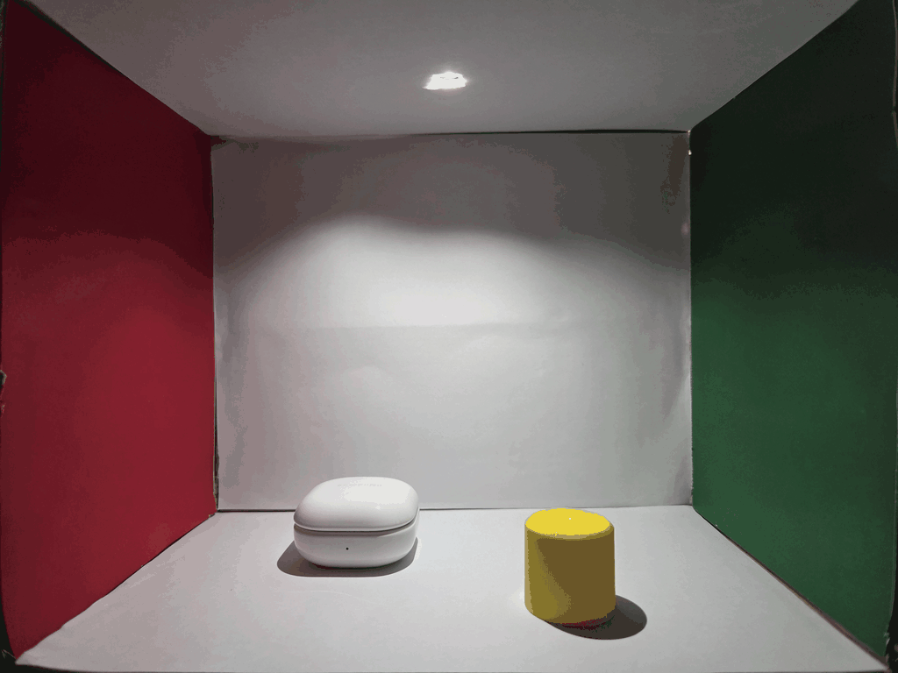

# Programming Assignment 2

## Scene Modeling

택배 상자를 이용해 Cornell Box를 제작하였다. 바닥·천장·뒷벽에는 흰색 A4 용지를, 왼쪽과 오른쪽 벽에는 각각 빨간색과 초록색으로 인쇄한 A4 용지를 딱풀로 부착하였다. 천장 중앙에는 광원을 배치하기 위한 1.0×1.0cm 구멍을 만들고, 내부에 이어폰 케이스와 노란색 딱풀 뚜껑을 놓았다.

장면은 Python과 pyglet으로 구현하였다. 1 단위를 1cm로 두고, 다음 치수를 적용하였다. 상자와 딱풀 뚜껑은 직접 길이를 측정하였고, 이어폰 케이스는 갤럭시 버즈 라이브의 제품 규격 정보를 사용하였다.

| 대상 | 크기 (cm) | 모델 |
| --- | --- | --- |
| 상자 내부 | 가로 25.0 × 높이 20.0 × 깊이 15.0 | 직육면체 판 |
| 이어폰 케이스 | 가로 5.0 × 높이 2.78 × 깊이 5.02 | 둥근 직육면체 |
| 딱풀 뚜껑 | 지름 3.0 × 높이 3.0 | 원기둥 |

케이스는 직육면체 표면을 세분화한 뒤 모서리 정점을 둥근 표면으로 이동시켰다. 모서리 반경은 사진의 형태를 근사하기 위해 1.3cm로 설정했으며, 중심보다 약간 위에 얇은 회색 띠를 추가하여 뚜껑 경계를 표현하였다. 딱풀 뚜껑은 원주를 32개 구간으로 나눈 원기둥으로 구현하였다.

각 모델에 이동과 스케일링을 적용하고 깊이 버퍼로 앞뒤 가림을 처리하였다. 사진과 비교하여 물체의 위치를 조정했으며, 초기 화면에서 빨간 벽이 왼쪽, 초록 벽이 오른쪽에 보이도록 설정하였다. Trackball은 예제의 구면 투영과 Quaternion 회전을 활용해 구현하였다.

## Camera Matching

사진은 Galaxy S25+로 촬영하였다. 원본 EXIF에서 해상도 4000×3000, 실제 초점거리 5.4mm, 35mm 환산 초점거리 23mm, 디지털 줌 1배를 확인하였다. 환산 초점거리를 대각선 화각 기준으로 해석하고, 4:3 이미지의 높이를 이용해 세로 FOV를 계산하였다.

$$
\mathrm{FOV}_y = 2\arctan\left(\frac{\sqrt{36^2 + 24^2}\cdot(3/5)}{2\cdot23}\right) \approx 58.88^\circ
$$

촬영 위치는 사진의 뒷벽 네 모서리와 천장 구멍 중심을 기준으로 추정하였다. 카메라는 바닥에서 약 10.49cm 높이, 상자 앞쪽에서 약 16.63cm 떨어진 위치에서 아래로 약 2.06도 바라보도록 설정하였다. 초기 창 크기는 사진과 같은 4:3 비율인 1024×768로 설정하였다.

## Installation and Usage

Python 3.11, pyglet 2.1.16과 OpenGL 3.3을 지원하는 그래픽 드라이버가 필요하다. Conda가 설치된 환경에서 압축을 해제한 프로젝트 폴더를 열고 다음 명령을 실행한다.

```powershell
conda env create -n graphics-pa2 -f environment.yml
conda activate graphics-pa2
python main.py
```

| 조작 | 동작 |
| --- | --- |
| 마우스 왼쪽 버튼 드래그 | Trackball 회전 |
| Shift + 왼쪽 버튼 드래그 | 이동 |
| Ctrl + 왼쪽 버튼 위아래 드래그 | 확대/축소 |
| R | 초기 시점 복원 |

## Results



실제 Cornell Box 사진에서 렌더링으로 서서히 전환되는 gif를 첨부하였다. [원본 사진](assets/reference.jpg)과 [렌더링 이미지](assets/render.png)를 함께 포함하였다.

## References

- [pyglet Documentation](https://pyglet.readthedocs.io/en/latest/): 창 생성, 입력 처리, 메시와 원근 투영 API.
- [TrackballViewer](https://github.com/snumrl/TrackballViewer), Trackball 회전, 이동, 확대 예제.
